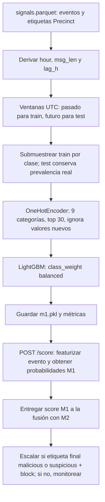
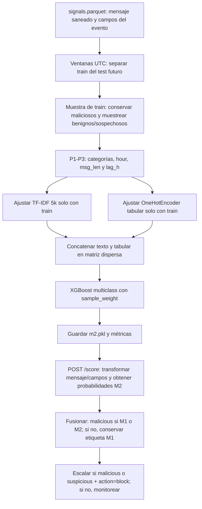
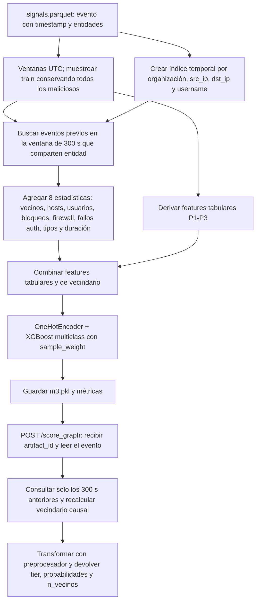

# Deteccion-triage-alertas-soc-2m-eventos

   

**Clasifica señales de seguridad para ayudar a un analista SOC a priorizar qué revisar; no automatiza una investigación ni sustituye su decisión.**

Sobre **2,011,674 eventos reales** (`witfoo/precinct6-cybersecurity` v2.1.0): el baseline tabular llega a F1-macro 0.628 pero casi no recupera lo malicioso (recall 0.011); el texto (M2, 0.623, recall malicioso 0.002 a umbral 0.5) tampoco generaliza el disparo a campañas futuras. El antiguo recall 0.97 se retira por fuga temporal. El resultado M3 de 0.719 es una cota medida con ventana ±5 min no causal, no el resultado de producción.

## Introducción: contexto SOC, problema y datos

### El problema operativo

Un **Security Operations Center (SOC)** es el equipo —personas, procesos y herramientas— que observa la actividad de una organización y coordina la respuesta ante incidentes. No recibe una sola alerta clara: consume telemetría de firewalls, auditoría de Windows, plataformas cloud, identidad, correo, servidores y herramientas de protección de endpoints. Cada fuente registra acciones distintas y con distinto nivel de contexto. Una fila aislada puede ser rutinaria; su relevancia cambia si pertenece a una cuenta comprometida, a un host investigado o a una secuencia de actividad sospechosa.

Por eso el problema de este proyecto es el **triage**: ayudar a priorizar qué señales merecen atención, qué evidencia revisar y cuándo escalar. El objetivo es apoyar la fase **Detect** de la respuesta a incidentes, no declarar que un ataque ocurrió ni ejecutar contención automáticamente. La guía actual [NIST SP 800-61 Rev. 3](https://csrc.nist.gov/pubs/sp/800/61/r3/final) sitúa la respuesta a incidentes dentro de la gestión continua del riesgo y conecta detección, respuesta y recuperación.

En la captura analizada hay **2,011,674 señales en seis días**, de cuatro organizaciones, 19 productos y 12 fabricantes. Solo **7,728 (0.38 %) son leads maliciosos de 1,584 incidentes observados en esa ventana**; 106,793 (5.31 %) son sospechosas y 1,897,153 (94.31 %) benignas. Los leads maliciosos terminan el 30 de julio, aunque el tráfico benigno continúa hasta el 1 de agosto. El equipo necesita revisar muchas señales para encontrar pocas; además, una actividad que parece normal por sí sola puede volverse relevante al relacionarla con una cuenta, un host o una cadena de eventos.

### Conceptos SOC y de redes que usa el proyecto

| Concepto | Significado aquí |
|---|---|
| **Evento / señal** | Registro normalizado que informa una acción observada por un producto: por ejemplo, una auditoría de Windows, un flujo de red o una acción de firewall. Es la fila de `signals.parquet`; no equivale automáticamente a un ataque. |
| **Regla de detección / lead** | Precinct aplica 261 reglas de detección. Una señal que activa una regla lead puede disparar o incorporarse a un incidente; `malicious` en esta captura identifica esos leads dentro de incidentes observados durante la ventana. |
| **Sospechoso** | Señal que coincide con al menos una regla, pero no es un lead de incidente. Es candidata a revisión, no confirmación humana de intrusión. |
| **Benigno** | Señal que Precinct dejó fuera de las etiquetas suspicious y malicious; no equivale a una certificación humana de que el evento sea seguro. |
| **Incidente** | Conjunto correlacionado de señales que Precinct agrupa para investigación. El dataset aporta sus relaciones de proveniencia y un reporte de caza; agrupar señales da contexto, pero no demuestra por sí solo causalidad. |
| **Triage / escalar o monitorear** | Validar la señal, enriquecerla con fuente, cuenta, host y actividad relacionada, estimar su alcance y decidir si requiere investigación. En esta app, la regla de escalamiento prioriza `malicious` y `suspicious` con `action=block`; no ejecuta bloqueo de red. |
| **MITRE ATT&CK** | Lenguaje común para describir comportamiento adversario: la táctica expresa el objetivo (“por qué”) y la técnica, el método (“cómo”). En este dataset las asociaciones ATT&CK vienen de la correlación/reglas de Precinct; el proyecto las presenta como hints, no como atribución independiente confirmada. |
| **Grafo de proveniencia** | Relaciones observadas entre entidades y señales —por ejemplo, usuario/credencial, host y acción— usadas para reconstruir qué actividad rodea un evento. La relación aporta contexto; no prueba que una entidad causó un ataque. |

### Qué dataset es y en qué formato viene

El proyecto usa el dataset público [WitFoo Precinct6 Cybersecurity v2.1.0](https://huggingface.co/datasets/witfoo/precinct6-cybersecurity), publicado bajo Apache-2.0 y derivado de telemetría empresarial procesada por Precinct 6.x. La versión completa contiene 114,421,340 señales live; aquí se usa su conjunto compañero de **2,011,674** señales de cuatro organizaciones, capturadas del **26 de julio al 1 de agosto de 2024**. Es un subconjunto determinista: conserva todos los leads maliciosos de la ventana, el tráfico de la misma organización dentro de ±5 minutos de esos leads y una selección uniforme adicional (seed 42). No es PCAP ni una colección de paquetes crudos: son **eventos normalizados y sanitizados**, con campos y mensajes de texto saneados.

En este repositorio el formato principal es **Apache Parquet**, un formato columnar adecuado para analizar tablas grandes y leer solo las columnas necesarias. Las señales y tablas de relaciones locales están en Parquet; la distribución pública también incluye grafos por incidente en GraphML y reportes/estructuras en JSONL. El pipeline local usa:

- `data/signals/signals.parquet`: 2,011,674 señales live y 38 columnas: `timestamp` de ingesta en Precinct, `event_time` del dispositivo (con faltantes), tipo/producto, organización, acción, protocolo, mensaje saneado, etiquetas e IDs de incidente.
- `data/signals/incident_signals.parquet`: 238,511 leads históricos (2022–2024), separados de la captura live para no mezclar cronologías en el entrenamiento principal.
- `data/graph/nodes.parquet` y `edges-00000.parquet`: 47,585 nodos y 1,740,438 relaciones de proveniencia.
- `data/graph/attack_reports.parquet`: reportes de caza asociados a 51,371 incidentes.

`artifact_id` sirve para relacionar una señal con objetos del grafo y `incident_ids` para ubicarla en un incidente. Los archivos Parquet no se incluyen en Git; [Hugging Face](https://huggingface.co/datasets/witfoo/precinct6-cybersecurity) y el generador [`dataset-from-precinct6`](https://github.com/witfoo/dataset-from-precinct6) documentan acceso y procedencia.

### Qué puede y qué no puede concluirse

Las etiquetas describen la salida de la correlación automática de Precinct, no una adjudicación de un analista para cada fila: **2,005,877 de las 2,011,674 señales constan como `Unprocessed`**. Hay que leer el modelo como aprendiz de las decisiones del motor, no como árbitro de la verdad de una intrusión. Las etiquetas automáticas, la concentración por organización y la actividad maliciosa que termina antes que el tráfico benigno limitan la generalización.

La propuesta de diapositivas [`Triage_Alertas_SOC.pptx`](reports/primera_entrega/Triage_Alertas_SOC.pptx) presenta el flujo operativo que guía el proyecto: **captura → saneamiento → 261 reglas lead → contexto de incidente (grafo y reporte) → vistas M1/M2/M3 → analista**. También usa Devign (grafos) y CVSS-BERT (texto) para motivar esas representaciones; son trabajos sobre tareas y etiquetas distintas, así que sus resultados no son comparables con los de Precinct6. El PPTX es una propuesta inicial: sus recalls esperados para M2/M3 son hipótesis, no resultados. Las mediciones finales y la corrección por fuga temporal están en §5 y en el paper.

Como referencia de dominio: [dataset y método de generación](https://huggingface.co/datasets/witfoo/precinct6-cybersecurity) · [NIST SP 800-61 Rev. 3](https://csrc.nist.gov/pubs/sp/800/61/r3/final) · [MITRE ATT&CK: tácticas y técnicas](https://attack.mitre.org/resources/faq).

## 1. Estructura del Proyecto

```text
.
├── app/                            # Despliegue: API FastAPI en :8000
│   └── main.py                     # /health /score /queue /incident /score_graph /explain /feedback
├── soc-ui/                         # Frontend React+TS (Cola/Incidente/Grafo/Cobertura/Lab/Panorama)
│   └── src/pages/                  # Queue.tsx Incident.tsx Graph.tsx Coverage.tsx Lab.tsx Panorama.tsx
├── src/                            # Código fuente modular
│   ├── dataset.py                  # carga local parquet
│   ├── explorar.py                 # util EDA rápido
│   └── eda_report.py               # EDA completo → reports/eda/ (checklist 2026)
├── experiments/                    # Entrenamiento reproducible (mismo split temporal 80/20)
│   ├── m1_tabular/train.py         # LightGBM tabular → models/m1.pkl
│   ├── m2_texto/train.py           # TF-IDF 5k + XGBoost → models/m2.pkl
│   ├── m3_grafo/train.py           # vecindario ±5min + XGBoost → models/m3.pkl
│   └── m1_tabular/leaderboard.csv  # 8 variantes MLflow (F1/F2/F3 × lgbm/xgb/rf/logreg)
├── models/                         # Serializados: m*.pkl NO en git · m*_metrics.json + m*_meta.json sí
├── data/                           # Parquets NO en git (ver §3)
│   ├── signals/ + graph/ + build/ + reference/
│   └── README_HF.md                # data card original WitFoo
├── notebooks/                      # EDA, entrenamiento y análisis; guía notebook por notebook en §5.1
│   ├── 00_eda_precinct6.ipynb       # EDA: dataset, desbalance, deriva, leakage y decisiones P1–P5
│   ├── 01_m1_tabular_variantes.ipynb # 8 variantes tabulares (F1/F2/F3) + comparación MLflow
│   ├── 02_m2_texto_tfidf.ipynb      # análisis M2: texto, evaluación honesta, errores y latencia
│   ├── 03_m3_grafo_vecindario.ipynb # análisis M3: vecindario causal y comparación M1/M2/M3
│   ├── 04_m4a_multilabel_logreg.ipynb # ATT&CK por evento: One-vs-Rest Logistic Regression
│   ├── 05_m4b_multilabel_xgb.ipynb  # ATT&CK por evento: XGBoost por técnica
│   ├── 06_m4c_multilabel_grafo.ipynb # ablación tabular/texto/grafo para ATT&CK
│   ├── 07_m4d_tacticas_xgb.ipynb    # multilabel por táctica ATT&CK
│   ├── 08_m5_anomalia_iforest.ipynb # Isolation Forest entrenado solo con benignos
│   ├── 09_m4t_umbrales.ipynb        # ajuste de umbrales por técnica con validación F2
│   └── 10_m6_incidente.ipynb        # clasificación por incidente: voto vs features agregadas
├── reports/
│   ├── paper.tex / paper.pdf       # artículo IEEE (3 pp)
│   ├── presentacion_final.tex/.pdf # Beamer para demo final (20 min)
│   ├── figures/                    # figuras generadas por EDA y notebooks
│   └── eda/                        # resumen_eda.md + diccionario_datos.csv (generado)
├── docs/                           # índice en §8
├── papers/                         # PDFs arXiv locales (NO en git, ver links en §8)
├── Dockerfile                      # multi-stage: node build + python:3.10-slim
├── compose.yml                     # un servicio, :8000
├── pyproject.toml + uv.lock        # dependencias pineadas (uv)
└── README.md
```

## 2. Requisitos e Instalación

- **Python exacto: 3.10** (los pickles son sklearn 1.7.2 / xgboost 3.2.0; el Dockerfile usa `python:3.10-slim` para igualar versiones y evitar warnings de unpickle). O Docker.
- Los parquets (`signals.parquet` 117MB, `edges` 34MB, modelos `*.pkl`) **no están en el repo**.

```bash
git clone https://github.com/nicothinn/Deteccion-triage-alertas-soc-2m-eventos.git
cd Deteccion-triage-alertas-soc-2m-eventos
uv sync
# descargar parquets a data/signals/ y data/graph/ desde:
# https://huggingface.co/datasets/witfoo/precinct6-cybersecurity
#   signals/signals.parquet, signals/incident_signals.parquet,
#   graph/nodes.parquet, graph/edges-00000.parquet, graph/attack_reports.parquet
```

## 3. Datos (Data Source)

- **Origen:** [`witfoo/precinct6-cybersecurity`](https://huggingface.co/datasets/witfoo/precinct6-cybersecurity) v2.1.0 (Apache-2.0) + variante 114M [`precinct6-cybersecurity-100m`](https://huggingface.co/datasets/witfoo/precinct6-cybersecurity-100m) (solo referencia de escala). Generado con [`dataset-from-precinct6`](https://github.com/witfoo/dataset-from-precinct6) (sanitización 4 capas, 261 lead rules).
- **Features (38 por señal):** identidad (`org_id`, `artifact_id` = join key al grafo, `src/dst_ip`, `username`), fuente (`message_type` ≈40 valores, `stream_name`, `product/vendor_name`, `pipeline`), contenido (`action`, `severity` ≈49% vacía, `protocol`, `message_sanitized`), y labels Precinct (`attack_techniques/tactics`, `mo_name`, `suspicion_score`, `disposition`, `incident_ids`). Ventana live 2024-07-26 → 08-01, 4 orgs.
- **Target:** `label_binary` = benign 1,897,153 (94.31%) / suspicious 106,793 (5.31%) / malicious 7,728 (0.38%, leads in-window de 1,584 incidentes). IR benign:malicious ≈ 245:1. Labels = correlación automática Precinct (oráculo fuerte pero imperfecto, no verdad analista).
- **Almacenamiento:** parquets fuera del repo (ver §2). Mirrors locales en `data/` para no re-descargar. Diccionario autogenerado: [`reports/eda/diccionario_datos.csv`](reports/eda/diccionario_datos.csv).

## 4. Pipeline del Proyecto (Cómo ejecutarlo)

Scripts de producción (no solo notebooks), mismo protocolo temporal 80/20 en los 3:

```bash
# Paso 0: EDA completo reproducible (checklist OMSCS/Insper 2026)
uv run python src/eda_report.py            # → reports/eda/resumen_eda.md

# Paso 1: entrenar los 3 modelos
uv run python experiments/m1_tabular/train.py --n 200000   # → models/m1.pkl + m1_metrics.json
uv run python experiments/m2_texto/train.py --n 30000      # → models/m2.pkl (TF-IDF 5k + XGBoost)
uv run python experiments/m3_grafo/train.py --n 30000      # → models/m3.pkl (vecindario ±5min + XGBoost)

# Paso 2: evaluar (métricas a models/*_metrics.json + MLflow en experiments/mlruns)
# Paso 3: servir
uv run uvicorn app.main:app --reload      # http://127.0.0.1:8000/health
```

## 5. Resultados y Evaluación del Modelo

Test temporal futuro en ventanas UTC fijas (train < 07-29, test 07-29→07-31, 0 incidentes compartidos de 1515/69). Métrica principal macro-F1 + PR-AUC por clase (accuracy es vacua: ≈94% con siempre-benign). Los números viejos con sample-then-split (M1 0.5991, M2 0.7084 con R mal 0.97) tenían fuga temporal y se retiran.

| Modelo | F1-macro | malicious P/R/F1 | PR-AUC mal | recall@1%FPR | train/test |
|---|---|---|---|---|---|
| Baseline M1 tabular LightGBM | **0.6276** | 0.2275 / 0.0107 / 0.0204 | 0.2333 | — | 137508 / 574132 |
| M2 TF-IDF 5k + XGBoost | **0.6232** | 0.2414 / 0.002 / 0.0039 | 0.218 | 0.4344 | 30000 / 574132 |
| M3 vecindario ±5 min + XGBoost (cota no causal) | **0.7186*** | 0.7946 / 0.9620 / 0.8703 | 0.8154 | 0.0376 | 24000 / 6000 |

\* El **0.7186** usa ventana ±5 min (incluye futuro): cota alta, no resultado de serve. El notebook `03` mide la ventana causal `[t-300s,t)` sobre una muestra balanceada: F1-macro 0.6043, recall malicioso 0.99, PR-AUC 0.5357; no es directamente comparable con M1/M2, evaluados sobre test con prevalencia real.

Lectura honesta: M1 ordena volumen y recupera suspicious (R 0.99) pero casi no detecta malicious; M2 tampoco generaliza al disparo futuro con umbral 0.5, aunque su ranking a 1% FPR llega a 0.43. M3 aporta contexto causal, pero sacrifica recall de suspicious. Figuras en `reports/figures/`: `label_distribution.pdf`, `temporal_volume.pdf`, `confusion_m1.pdf`, `architecture.pdf`. Detalle de leakage en `notebooks/01_m1_tabular_variantes.ipynb` §6.5.

### 5.1 Guía de notebooks y modelos

| Notebook | Qué hace | Resultado / lectura |
|---|---|---|
| `00_eda_precinct6` | Explora datos, labels, deriva, entidades y texto; fija P1–P5 y riesgos de leakage. | Justifica split temporal y representaciones tabular, texto y grafo. |
| `01_m1_tabular_variantes` | Compara 8 combinaciones de algoritmos y features F1/F2/F3; registra MLflow. | Grid exploratorio con split antiguo sample-then-split: recalls altos no son resultado final. M1 LightGBM se conserva por latencia; evaluación vigente en ventanas UTC: F1 0.6276, recall malicious 0.0107. |
| `02_m2_texto_tfidf` | Evalúa M2 ya entrenado en test UTC futuro; muestra confusión, PR, tokens, latencia y errores. | F1 0.6232; recall malicious 0.002 a umbral 0.5; recall@1%FPR 0.4344. El texto aporta ranking, no disparo confiable. |
| `03_m3_grafo_vecindario` | Evalúa M3 con vecinos causales `[t-300s,t)` por host/credencial; compara con M1/M2. | En muestra balanceada: F1 0.6043 y recall malicious 0.99; complementario a M2. El 0.7186 de ±5 min es cota no causal. |
| `04_m4a_multilabel_logreg` | Predice 6 técnicas ATT&CK por evento con One-vs-Rest Logistic Regression y compara con oráculo-tier. | Micro/macro-F1 0.7484/0.2516; T1190 domina; PR-AUC(score) T1041/T1567 0.183/0.182, T1204 0.227. LBFGS no convergió a 1000 iteraciones: lectura indicativa. |
| `05_m4b_multilabel_xgb` | Repite ATT&CK por evento con un XGBoost binario por técnica y ponderación de clase. | Micro/macro-F1 0.7926/0.2557; T1041/T1567 P/R 0.08/0.06, PR-AUC(score) 0.188/0.192; T1204 PR-AUC 0.301 con 10 positivos. No se despliega. |
| `06_m4c_multilabel_grafo` | Ablación tabular, texto, grafo y combinación para las mismas técnicas. | E2 tabular+grafo, micro/macro 0.8571/0.2957; T1041/T1567 F1 0.07/0.06. Ventana ±300s incluye futuro: cota alta, no serve. |
| `07_m4d_tacticas_xgb` | Predice 5 tácticas ATT&CK por evento; PR-AUC usa scores continuos. | Micro/macro-F1 0.8772/0.4264; TA0001/TA0002 casi constantes (F1 1.00/0.99), TA0009/TA0010 F1 0.07 y TA0040 sin soporte. No se despliega. |
| `08_m5_anomalia_iforest` | Entrena Isolation Forest solo con benignos pasados; evalúa test futuro enriquecido. | Recall de malicious/suspicious 0, FPR benigno 0.113, ROC-AUC 0.174. PR-AUC 0.7243 ≈ prevalencia de test 0.719; no es detector operativo. Guarda `m5_metrics.json`. |
| `09_m4t_umbrales` | Ajusta en validación un umbral F2 por técnica y compara con 0.5 fijo. | Macro-F1 tuned/fijo 0.3539/0.3536; T1041/T1567 alcanzan recall 0.968/0.993 con precisión ≈0.22. Mueve el punto operativo, no crea señal nueva. |
| `10_m6_incidente` | Compara voto máximo de scores por incidente (M6a) con XGBoost sobre features agregadas (M6b). | M6a micro/macro 0.9998/0.4999; M6b 0.9999/0.5000. Head casi constante; T1204 tiene 4 positivos y T1486/T1566 ninguno. No se despliega. |

**Resumen:** M1/M2/M3 estudian el triage; M4a–M4d y M4t estudian la atribución ATT&CK; M5 evalúa anomalías; M6 prueba clasificación por incidente. Los hints ATT&CK servidos por la consola provienen del mapeo de tiers/reglas, no de los modelos multilabel débiles.

### 5.2 Por qué se probaron y qué concluimos en contexto

**M1–M3: volumen, contenido y contexto.** El SOC necesita primero reducir el volumen sin ocultar ataques. M1 es el baseline tabular rápido: sirve para ordenar y recuperar sospechosos, pero su recall malicioso de 0.0107 muestra que los campos de una sola señal no bastan. El grid antiguo dio mejores números a algunas variantes (por ejemplo, LogReg-F2), pero usó sample-then-split y no se promueve; LightGBM queda por latencia. Por eso se probó M2 sobre el mensaje: a umbral 0.5 tampoco dispara en campañas futuras, aunque su ranking rescata 0.434 de maliciosos dentro del 1 % de falsos positivos. M2 aporta una segunda señal, no una decisión automática. M3 prueba la tercera fuente: el vecindario causal de host/credencial. En muestra balanceada recupera 99 % de maliciosos, pero solo 7 % de sospechosos; ayuda a reconocer cadenas y complementa a M2, aunque aún no hay evaluación causal sobre todo el test de prevalencia real.

**M4a–M4t: ¿podemos asignar ATT&CK por evento?** Se probaron modelos lineales, XGBoost, contexto de grafo, tácticas y ajuste de umbrales. El patrón común es que T1190 y algunas tácticas son casi constantes por cómo Precinct etiqueta los eventos, mientras que la cola tiene pocos o ningún ejemplo. En M4a, T1041/T1567 tienen PR-AUC(score) 0.183/0.182; M4b sube apenas a 0.188/0.192 con XGBoost. El grafo de M4c mejora algo la macro, pero usa ±300 s e incluye futuro; M4d tiene macro alta por las etiquetas frecuentes; M4t cambia el intercambio recall/precisión, pero no crea separación. Además, M4t entrena hasta el cuantil 60 y M4b hasta el 80: no atribuir su diferencia de métricas solo al umbral. **Conclusión:** la consola muestra técnicas como hints derivados del tier/reglas, no como predicciones multilabel aprendidas.

**M5: ¿una red de seguridad para ataques nuevos?** Se probó Isolation Forest solo con benignos porque las etiquetas automáticas tienen revisión humana limitada. El test está deliberadamente enriquecido (71.9 % amenaza), no refleja la prevalencia SOC. Aun así, el recall de malicious es cero, el FPR benigno 11.3 % y ROC-AUC 0.174; PR-AUC 0.7243 apenas supera la prevalencia del test (0.719). **Conclusión:** con estos features tabulares no funciona como detector zero-day ni debe generar escalamiento.

**M6: ¿agrupar por incidente resuelve la cola?** Se comparó voto máximo por incidente con features agregadas. Los micro-F1 cercanos a 1 no indican capacidad real: T1190/T1041/T1567 aparecen en los 9.688 incidentes de test y T1204 tiene solo cuatro ejemplos. En T1204, PR-AUC es 0.2225 para M6a y 0.0003 para M6b. **Conclusión:** las etiquetas hacen la tarea casi constante; no desplegar M6.

**Lectura conjunta.** La utilidad demostrada es priorizar y reunir evidencia para el analista dentro de patrones/campañas observados; no afirmar detección autónoma de campañas futuras ni atribución ATT&CK confiable. Las métricas vigentes usan ventanas UTC fijas para M1/M2. Los resultados antiguos del EDA y de las variantes M1 con sample-then-split (incluido el recall M2 ≈0.97) se consideran exploratorios y quedan retirados por fuga temporal. Para M3, 0.7186 es una cota no causal; 0.6043 viene de una muestra causal balanceada y no se compara directamente con M1/M2.

### 5.3 Pipeline de los tres modelos servidos

Los diagramas muestran pasos de preparación/entrenamiento y la ruta que sigue un evento al servirse. M1 y M2 se combinan en `POST /score`; M3 tiene una consulta contextual separada en `POST /score_graph` mediante `artifact_id`.

#### M1 — campos tabulares



#### M2 — texto del evento + campos tabulares



#### M3 — evento + vecindario de proveniencia



**Nota de operación:** M3 calcula la vecindad desde señales de `signals.parquet` que comparten organización, `src_ip`, `dst_ip` o `username`; no es una GNN que consuma directamente `edges.parquet`. El servicio usa la ventana causal `[t-300s,t)`. No usar el 0.7186 de la evaluación ±5 min como rendimiento de esa ruta: es una cota no causal; la medición causal disponible usa una muestra balanceada.

## 6. Despliegue e Inferencia (Deployment)

```bash
# Local
uv run uvicorn app.main:app --reload

# API: ejemplo con curl
curl -X POST http://127.0.0.1:8000/score \
  -H "Content-Type: application/json" \
  -d '{"message_type":"firewall_action","action":"block","message":"exploit T1190 test"}'
# → {"label":"malicious","proba":{...},"triage":"escalar","m2":{...}}

# Docker (recomendado demo: API + web en un :8000)
docker compose up --build
# UI: http://127.0.0.1:8000
# detener: docker compose down
```

Endpoints: `GET /health /info /stats /queue?label&limit /incident/{id} /graph/vecindario?node` · `POST /score /score_batch /score_graph /explain /feedback`. La consola React (`soc-ui/`, `npm run dev`) consume solo esos endpoints; `/` sirve la web. Regla de triage: `escalar` iff malicious o (suspicious + action=block).

## 7. Tecnologías Utilizadas

- **Core:** Python 3.10, Pandas, PyArrow, Scikit-Learn, LightGBM, XGBoost, Matplotlib/Seaborn.
- **MLOps / Tracking:** MLflow (`experiments/mlruns`), uv + `uv.lock` pineado.
- **API / Despliegue:** FastAPI, Uvicorn, Docker (+ Compose), React+TS+Vite (ECharts, ReactFlow), Hugging Face Datasets.

## 8. Documentación y Referencias

| Quiero... | Lee |
|---|---|
| Entenderlo todo end-to-end (recomendado) | [`docs/documentacion_end_to_end.md`](docs/documentacion_end_to_end.md) |
| No soy técnico | [`docs/glosario_soc_no_tecnico.md`](docs/glosario_soc_no_tecnico.md) |
| Qué datos son y sus límites | [`docs/datasheet.md`](docs/datasheet.md) (Gebru) + [`reports/eda/resumen_eda.md`](reports/eda/resumen_eda.md) + [`reports/eda/diccionario_datos.csv`](reports/eda/diccionario_datos.csv) |
| Qué hace cada modelo | `reports/paper.pdf` §5–6 + página Lab en la consola (`/lab`) |
| Propuesta primera entrega (IEEE + casos + punto 1) | [`reports/primera_entrega/propuesta_primera_entrega.pdf`](reports/primera_entrega/propuesta_primera_entrega.pdf) · [`docs/casos_primera_entrega.md`](docs/casos_primera_entrega.md) · [`docs/desarrollo_punto1.md`](docs/desarrollo_punto1.md) |
| Consigna del curso | [`docs/guia_proyecto.md`](docs/guia_proyecto.md) (`contexto/course_project_guide.pdf`) |
| Literatura del primer entregable | [`docs/referencias_primer_entregable.md`](docs/referencias_primer_entregable.md) |
| Presentación práctica final (20 min) | [`reports/presentacion_final.pdf`](reports/presentacion_final.pdf) ([LaTeX Beamer](reports/presentacion_final.tex)) |
| Paper final | [`reports/paper.pdf`](reports/paper.pdf) ([`.tex`](reports/paper.tex)) |

Dataset y pipeline: [2M](https://huggingface.co/datasets/witfoo/precinct6-cybersecurity) · [100M](https://huggingface.co/datasets/witfoo/precinct6-cybersecurity-100m) · [dataset-from-precinct6](https://github.com/witfoo/dataset-from-precinct6) · [research WitFoo](https://witfoo.com/research). Marco: [ATT&CK](https://attack.mitre.org/) · [Navigator](https://mitre-attack.github.io/attack-navigator/) · [Design & Philosophy](https://attack.mitre.org/docs/ATTACK_Design_and_Philosophy_March_2020.pdf). Provenance IDS: [NODLINK](https://arxiv.org/abs/2311.02331) ([DOI](https://doi.org/10.14722/ndss.2024.23204)) · [KnowHow](https://arxiv.org/abs/2509.05698) · [FLASH](https://doi.org/10.1109/sp54263.2024.00139) ([código](https://github.com/DART-Laboratory/Flash-IDS)) · [PROVSYN](https://arxiv.org/abs/2506.06226) · [OMNISEC](https://arxiv.org/abs/2503.03108) · [Survey](https://arxiv.org/abs/2006.01722) · [threaTrace](https://arxiv.org/abs/2111.04333) · [GraphSAGE](https://arxiv.org/abs/1706.02216) · [E-GraphSAGE](https://arxiv.org/pdf/2103.16329v8) · [PIDSMaker](https://ubc-provenance.github.io/PIDSMaker/tutorial/). Imbalance/texto/sim: [Focal Loss](https://arxiv.org/abs/1708.02002) · [Cost-sensitive IDS](https://arxiv.org/pdf/0807.2043) · [PWG-IDS](https://arxiv.org/abs/2110.03445) · [TF-IDF vs MiniLM](https://arxiv.org/abs/2407.06753) · [CybORG](https://arxiv.org/abs/2002.10667) · LightGBM (Ke et al., NeurIPS 2017).

**Limitaciones:** labels = correlación automática Precinct (no verdad analista); T1190 domina malicious; ORG-0004 49.5%; `severity` 49% vacía por construcción. Detalle en paper §Limitations.
